# Robotic packaging and palletizing line

A complete production line simulated in [CoppeliaSim](https://www.coppeliarobotics.com/) and driven
from Python: a delta robot packs products from one conveyor into cartons on another, a cobot
palletizes the cartons, a large industrial robot and a mobile robot move the pallets, a camera with
a neural network grades every product, and a humanoid robot sorts the rejects. An operator
dashboard in the browser shows the line live and controls it.

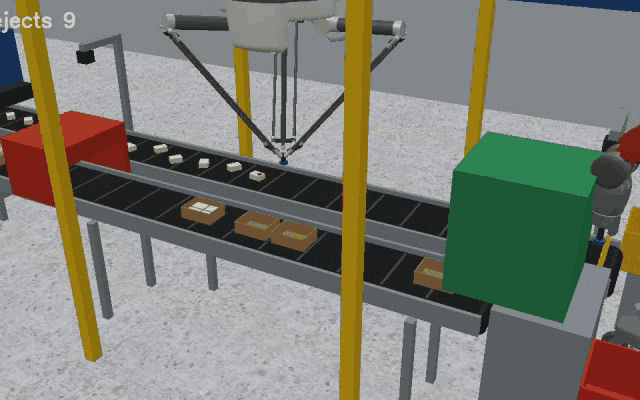

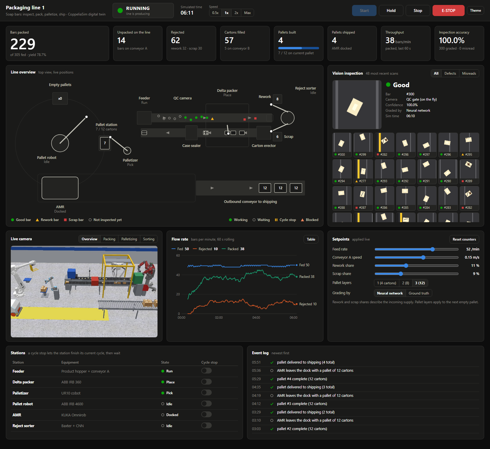

## The line

| # | Station | Robot / equipment | What it does |
|---|---------|-------------------|--------------|
| 1 | Infeed | Feeder + conveyor A | Soap bars arrive at random position and angle; about 20 % carry a defect |
| 2 | Vision QC | Camera + CNN | Grades every bar on the fly: `good`, `rework` (small blemishes), `scrap` (crack / burn) |
| 3 | Packing | ABB IRB 360 delta | Tracks good bars on the moving conveyor, aligns them and places 4 per carton on conveyor B |
| 4 | Carton transport | Conveyor B in two sections | The indexing section stops while a carton is filled, so waiting cartons stop with their belt; the outfeed section always runs, through the case sealer, and full cartons queue nose to tail at the end stop |
| 5 | Palletizing | UR10 cobot (vacuum) | Stacks 12 cartons per pallet in 3 mirrored layers |
| 6 | Pallet handling | ABB IRB 4600 + fork | Takes the full pallet to the mobile robot and fetches an empty pallet from the stack |
| 7 | Intralogistics | KUKA Omnirob (AMR) | Carries the pallet to the outbound roller conveyor and returns to its dock |
| 8 | Reject sorting | Baxter humanoid + CNN | Re-inspects each rejected bar and bins it with the left (scrap) or right (rework) arm |

| | |
|---|---|
| 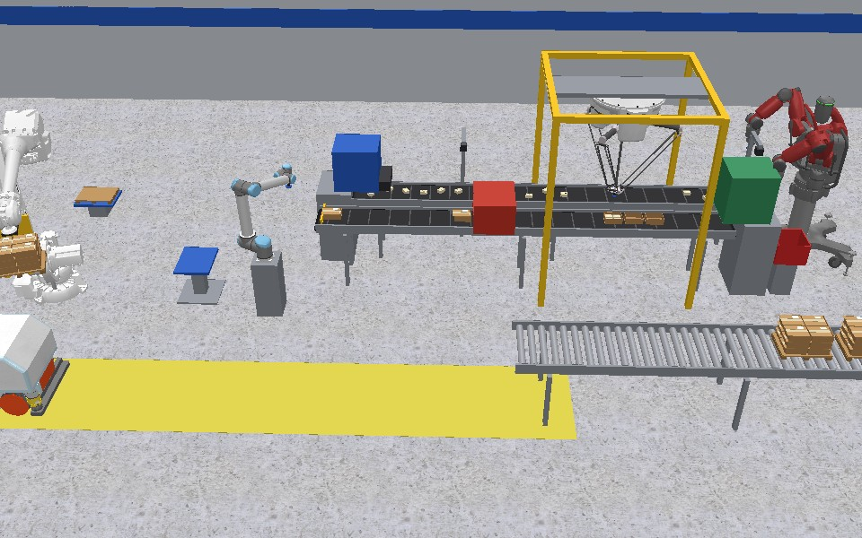 | 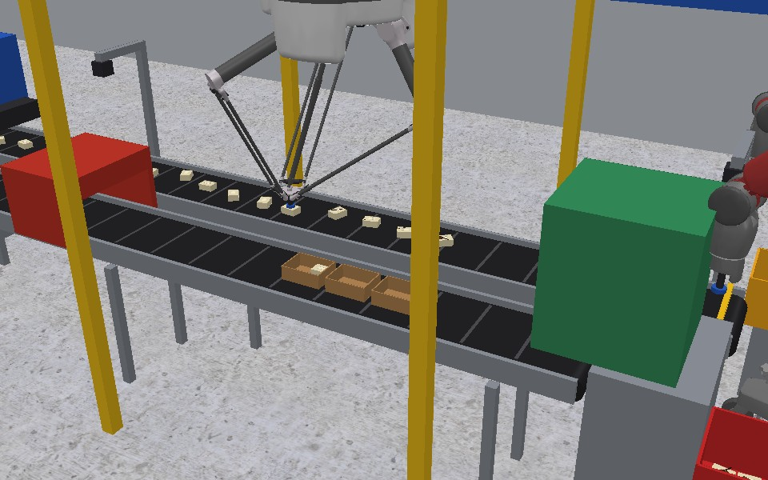 |
| 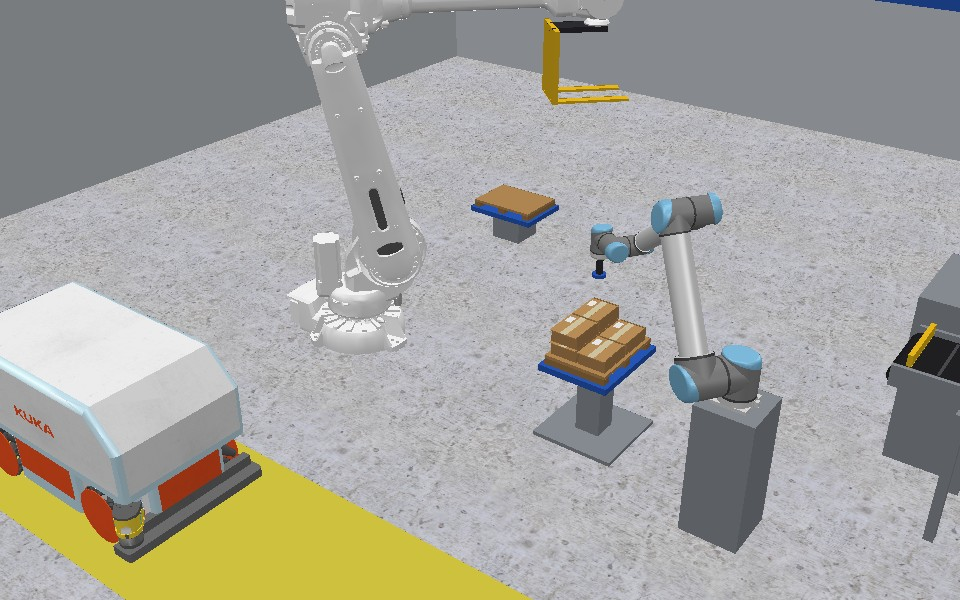 | 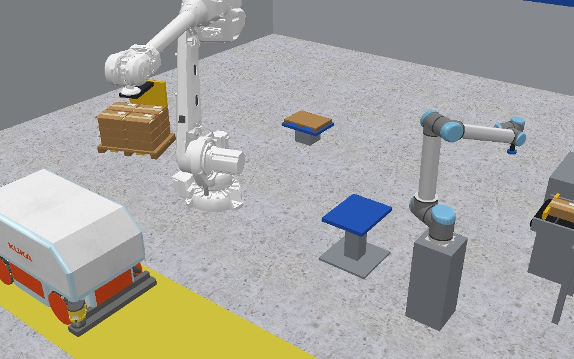 |
| 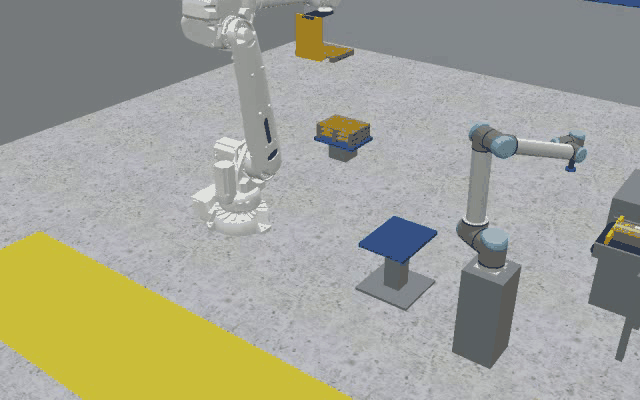 | 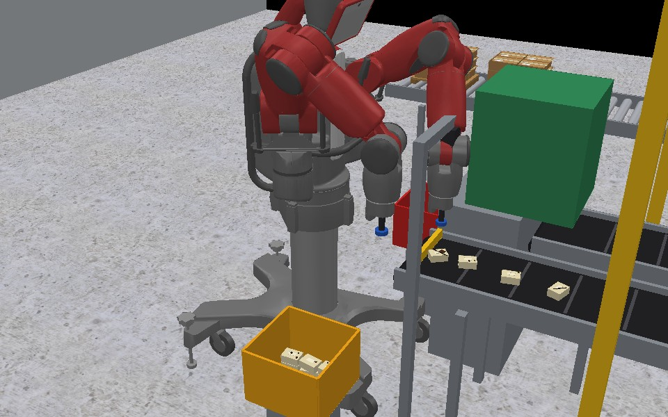 |

## Operator dashboard

`python -m factory.dashboard` serves a local web page (http://127.0.0.1:8050) that runs outside
the simulator and owns the line:

* **Key figures**: bars packed, bars still unpacked on the line, rejects (rework / scrap), cartons,
  pallets built and shipped, throughput, and inspection accuracy.
* **Line overview**: a live top view with every bar (shape and colour show its grade), carton fill
  levels, robot positions, the pallet being built, the AMR and the outbound pallets.
* **Vision inspection**: the pictures the cameras take, each with its grade and confidence; filter
  to defects or to misreads, click a thumbnail to inspect it.
* **Live camera**: four scene cameras rendered by the simulator.
* **Flow rate**: fed, packed and rejected bars per minute, with a hover readout and a table view.
* **Control**: Start, Hold / Resume, Stop and E-STOP; live setpoints for feed rate, conveyor speed,
  defect shares, pallet layers and the grading source; a cycle stop per station; simulation speed.
* **Event log**: pallets completed, AMR departures, misreads, operator actions.

The page uses no external libraries and only accepts commands from itself on `127.0.0.1`.

## Machine vision

A small CNN grades 128x128 top-down images taken by two cameras in the scene (one above the moving
infeed conveyor, one at the reject stop in front of Baxter).

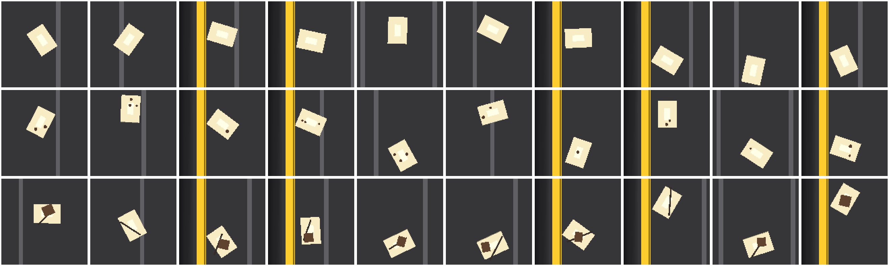

Every class has 60 different bars with random blemishes, cracks and burns. The split is by bar
identity (40 train, 8 validation, 12 test), so test bars are never seen in training. The shipped
model scores 100 % on the 576 test images (`factory/models/qc_metrics.json`). The defects are
synthetic and high-contrast, so this number says the pipeline works, not how it would do on real
products.

### Does it hold up on real defects?

Tested on two public sets of photographs from real production: 1,344 magnetic tile surfaces
(defect-free plus five defect types, 71 % defect-free) and 1,800 hot-rolled steel strip patches
(NEU-CLS, six defect types). All scores are on pictures held out from training, averaged over five
random 60 / 20 / 20 splits.

| Test | Magnetic tiles | Steel strip |
|---|---|---|
| Network trained on the simulated bars, used as it is | stops 3.6 % of defective tiles | flags 16.3 % of the defects |
| Same network retrained on real photos, same recipe (50 epochs) | 73.1 % correct, no better than always answering "good" (70.8 %) | 98.0 % correct |
| Retrained with 200 epochs, nothing else changed | 92.9 % correct; stops 85.9 % of defective tiles, rejects 2.2 % of good ones | 99.1 % correct |
| Accept / reject decision only, 200 epochs, class-weighted | 94.6 % correct; stops 93.8 % of defective tiles, rejects 5.1 % of good ones | not applicable (no defect-free class) |

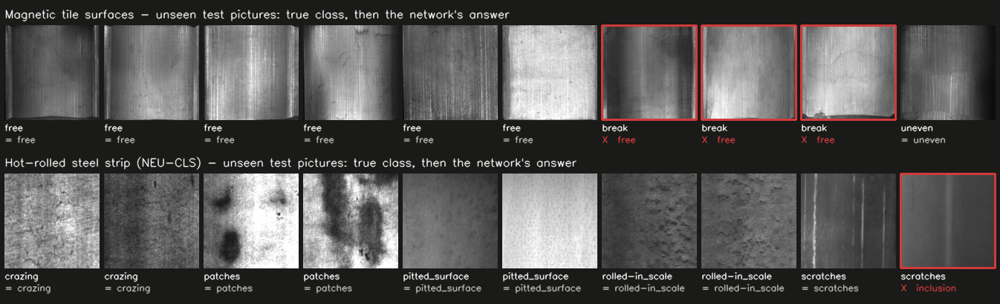

What this shows:

* The simulated-bar model does not transfer. It calls nearly every real part good.
* The pipeline itself does carry over: the same small network learns real steel defects to 98-99 %
  from about 1,080 photos.
* On magnetic tiles the unchanged recipe fails because it stops too early (it only fits 75 % of
  its own training pictures). Training four times longer fixes that, but one defective tile in
  seven to sixteen still gets through, which is too many for a real line. The rare classes are
  the weak spot (57 % of "fray" defects found, from 32 photos in total).

Limits of the test: the splits are random, and neither set says which photos show the same
physical part, so the scores may be optimistic; pictures are shrunk to 128x128 greyscale; no
comparison with published results was made. Numbers and per-class detail are in
`factory/models/real_world_results.json`. The datasets are downloaded on demand and are not part
of this repository:

* Magnetic tile defects: Huang, Qiu and Yuan, "Surface defect saliency of magnetic tile" (2020),
  [authors' repository](https://github.com/abin24/Magnetic-tile-defect-datasets.).
* NEU-CLS: Song and Yan, Northeastern University;
  [Figshare copy](https://figshare.com/articles/dataset/NEU-CLS/28903550), CC BY 4.0.

### Real parts on the conveyor

The magnetic-tile photographs can also run through the line itself: each photo becomes the top
of a 58 mm textured part, the inspection cameras zoom in on it, and the delta robot, the cobot and
Baxter handle it exactly like a soap bar.

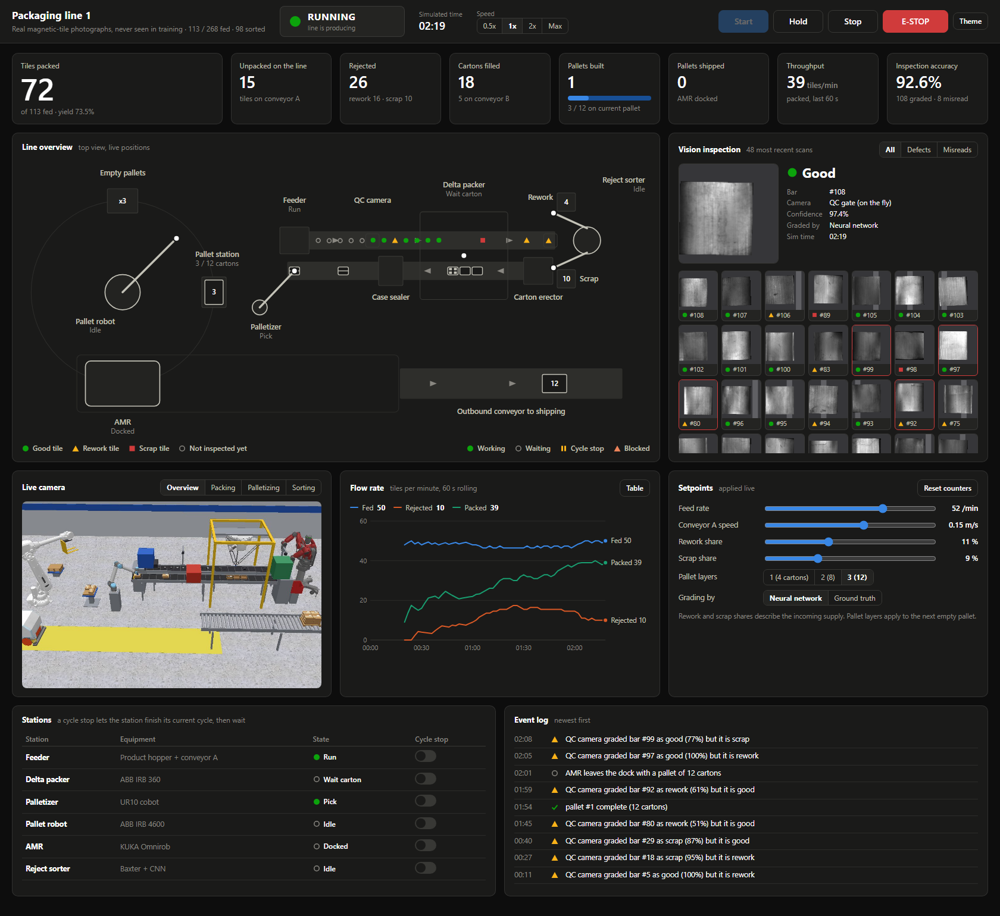

The tiles are split once by defect type: 806 train the network (it learns from pictures of them
taken by the scene cameras), 270 pick the training epoch, and the remaining 268 are fed to the
line. Neither the network nor the epoch choice has seen those 268. Tile defects are mapped to the
line's grades as rework (blowhole, uneven) or scrap (break, crack, fray); that mapping is my
assumption, not part of the dataset.

Where the 268 unseen tiles physically ended up:

| True grade | Packed in a carton | Rework bin | Scrap bin |
|---|---|---|---|
| Good (190) | **181** | 7 | 2 |
| Rework (44) | 9 | **31** | 4 |
| Scrap (34) | 3 | 2 | **29** |

* 241 of 268 tiles (89.9 %) ended up in the right place.
* 66 of the 78 defective tiles (84.6 %) were kept out of the cartons; 12 were packed.
* 9 of the 190 good tiles (4.7 %) were thrown out.
* The robots handled every tile; the camera gate graded 245 of 268 (91.4 %) correctly.

So the line works end to end on real parts, but a 15 % defect escape rate is far from what a real
inspection station would be allowed. The same weak spot as in the offline test: subtle surface
flaws, especially the rework class. Rerunning gives the same result (fixed seed); the counts are
saved in `factory/models/qc_tiles_line_run.json`.

## Run it

Requirements: CoppeliaSim 4.10 (the Edu version is fine) and Python 3.10+.

```bash
pip install -r requirements.txt
```

Open `factory.ttt` in CoppeliaSim, then:

```bash
python -m factory.dashboard
```

Press **Start** on the page. Without the dashboard:

```bash
python -m factory.controller --realtime
```

Other entry points:

| Command | Purpose |
|---|---|
| `python -m factory.build_scene` | Rebuild the whole scene from code and save `factory.ttt` (needs `factory.ttt` or a new, empty scene open; it refuses to wipe any other scene) |
| `python -m factory.train_qc` | Collect a fresh image set from the cameras and retrain the network |
| `python -I factory/real_data.py` | Download and convert the two real-defect datasets (about 77 MB) |
| `python -m factory.real_world` | Run the real-defect benchmark (about 25 minutes on a laptop GPU) |
| `python -m factory.real_parts` | Photograph the training tiles through the scene cameras and train the tile network |
| `python -m factory.controller --parts tiles` | Run the line on the 268 held-out real tiles and print where each ended up |
| `python -m factory.dashboard --parts tiles` | The same, on the dashboard |
| `python -m factory.record --time 210 --view all --video out/line.mp4` | Record the scene cameras to a video |
| `python -m factory.record --time 60 --check` | Print how closely each robot follows its targets |

## How it works

* `factory/build_scene.py` creates every object through the remote API: conveyors, gantry, tools,
  stands, bins, cameras, product / carton / pallet masters, and inserts the stock robot models.
* `factory/controller.py` is the cell controller. Each station is a Python coroutine advanced once
  per simulation step. They coordinate through shared line state (carton queue, pallet station, AMR
  dock), which gives natural back-pressure when a station is busy or stopped.
* `factory/bridge.lua` is a small script inside the scene. It solves the inverse kinematics of all
  five arms, including the delta's closed chains, and applies all pose updates of a step in one
  remote call, which keeps the simulation faster than real time.
* `factory/dashboard.py` + `factory/dashboard.html` are the dashboard server (Python standard
  library only) and page.
* `factory/vision.py` + `factory/train_qc.py` hold the network and its training pipeline.
* `factory/real_data.py` + `factory/real_world.py` fetch public real-defect photos and benchmark
  the same network and training recipe on them.
* `factory/real_parts.py` turns tile photos into textured parts, collects camera pictures of them
  and trains the network the line uses in `--parts tiles` mode.
* `factory/layout.py` holds every dimension and position.

In a 400 s validation run the line packed 257 of 341 bars into 64 cartons, built 5 pallets, missed
no good bar, had no IK failure and kept every tool within 0.5 mm of its planned path, at about
twice real time.

## Limits

* The simulation is kinematic. Robots follow planned tool paths through IK and parts attach to
  grippers by re-parenting; contacts, friction and payload dynamics are not simulated.
* Robot paths are not collision-checked.
* The robot models come from CoppeliaSim's model library.
